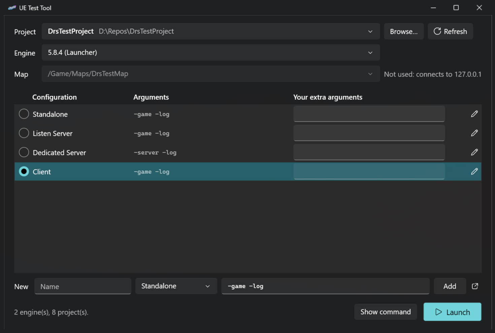

# UE Test Tool

Launch Unreal Engine projects for testing (Standalone, Listen Server, Dedicated Server, Client, or your own configurations) without typing command lines.



It follows the Windows light/dark mode and accent colour. It doesn't need to live in a project folder: run `UETestTool.exe` from anywhere.

## Using it

1. **Project**: pick any Unreal project on your machine. The list is built from Unreal's own recent-project lists and the folders Unreal creates projects in. Use **Browse…** for anything not found automatically.
   - Projects stay in the list even after Unreal forgets them (e.g. after an engine upgrade).
   - Right-click a project to remove it from the list.
   - Projects on a disconnected drive are greyed out until it's back.
2. **Engine**: every installed engine, both launcher installs and registered source builds. If it doesn't match the project's engine, a warning appears with a **Switch** button.
3. **Map**: the maps in the project's `Content` folder and in its content plugins. With the list focused, type the start of a map's name to jump to it.
4. **Configuration**: choose how to launch. Add your own extra arguments to any configuration in the right-hand box; they're remembered per configuration, just for you.
5. **Launch**, or double-click a configuration.

**Show command** reveals the full command line, including the project and map that are added automatically.

**Refresh** searches again for engines, projects and maps, and re-reads the project's config files (e.g. after a `git pull`).

### Built-in configurations

| Configuration | Launches as |
|---|---|
| Standalone | `<map> -game -log` |
| Listen Server | `<map>?listen -game -log` |
| Dedicated Server | `<map> -server -log` |
| Client | `127.0.0.1 -game -log` (no map: connects to a server on this machine) |

The editor executable and the `.uproject` path are always added in front.

## Adding configurations for a project

Use the **New** row at the bottom of the window:

- **Name**: what to call it, e.g. `Client (noHMD)`.
- **Template**: an existing configuration to base it on. The new configuration launches the same way (map, `?listen` or connect address) and starts with the template's arguments.
- **Arguments**: edit or extend them, e.g. add `-noHMD -WINDOWED -ResX=1200 -ResY=800`.
- Click **Add**.

Use ✎ on a configuration to edit it (or to copy it under a new name), and 🗑 to delete it. Saving under a built-in's name overrides that built-in for this project.

Configurations are saved in the project's **`Config/UETestTool.ini`**. Commit this file and everyone on the project gets them.

### `Config/UETestTool.ini` format

The file can also be edited by hand; the app keeps comments and ordering.

```ini
; UE Test Tool launch configurations for this project.

[Config.Client (noHMD)]
Template=Client
Args=-game -log -noHMD -WINDOWED -ResX=1200 -ResY=800

[Config.LAN Client]
Template=Client
Connect=192.168.0.10

; Overrides the built-in Standalone for this project
[Config.Standalone]
Args=-game -log -noHMD
```

| Key | Meaning |
|---|---|
| `Template` | A built-in configuration, or one defined earlier in the file. Its launch behaviour is inherited, and so are its `Args` if the section has none. |
| `Args` | The command-line arguments. |
| `Map` | Optional, `True` or `False`: whether the selected map is passed. |
| `MapOptions` | Optional, appended to the map, e.g. `?listen`. |
| `Connect` | Optional, an address to connect to instead of opening a map. |

Problems such as an unknown template are shown as a warning under the list; the file still loads.

## Where things are stored

| What | Where |
|---|---|
| Shared configurations (commit this) | `<Project>/Config/UETestTool.ini` |
| Your last map, configuration, engine and extra arguments for a project | `<Project>/Saved/UETestTool/User.ini`. `Saved` is normally git-ignored. |
| Known projects, last project, window position | `%LOCALAPPDATA%\DrsUnrealTools\UETestTool\settings.json` |

## Building

See the [repository README](../../README.md#building).

To regenerate the icon from `Assets/IconSource/*.png`:

```powershell
powershell -ExecutionPolicy Bypass -File Tools\UETestTool\Assets\make-icon.ps1
```
